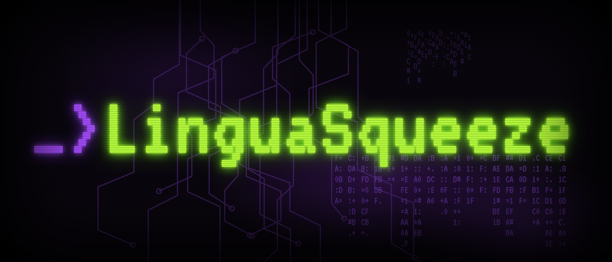
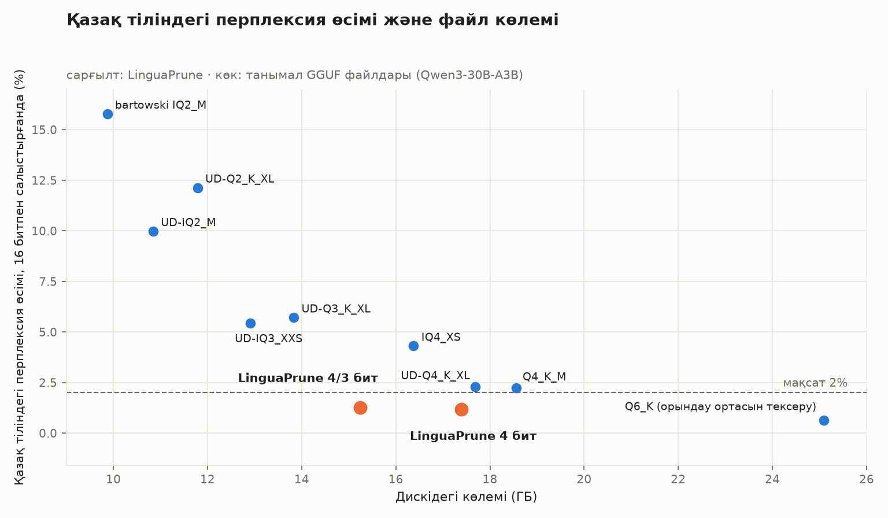
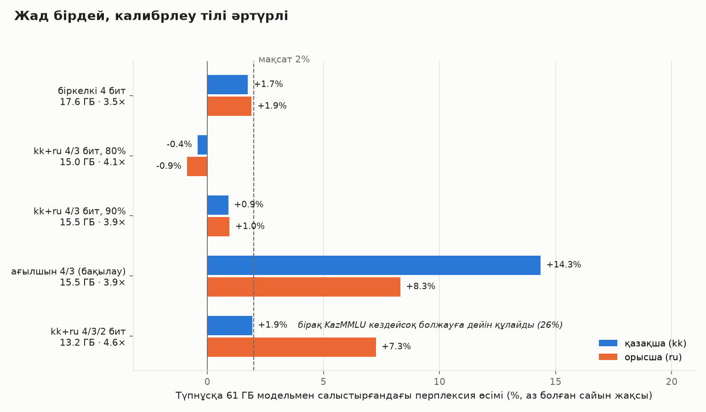
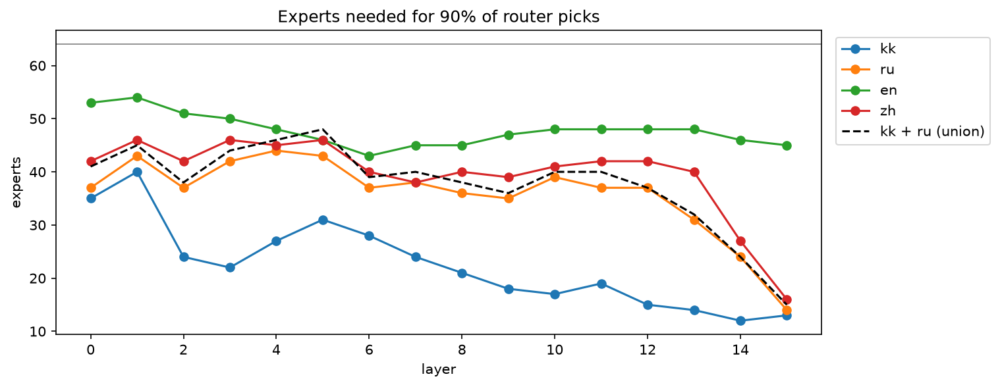
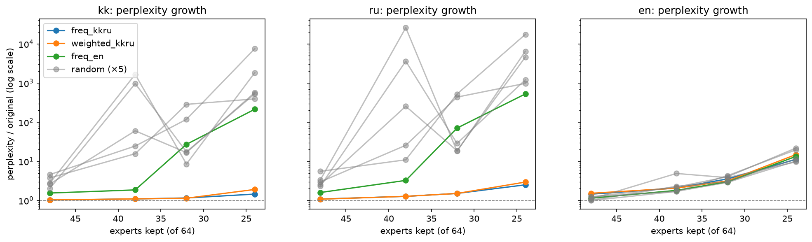
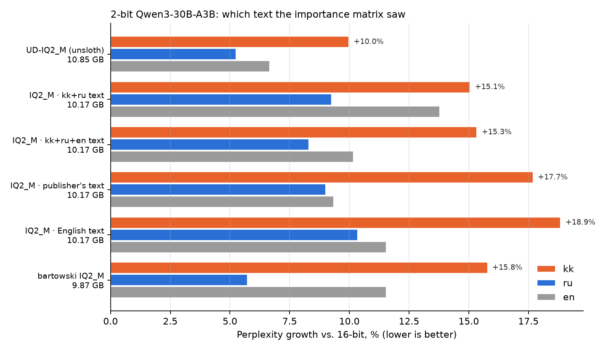

<div align="center">



**Mixture-of-Experts LLM-дерін тілді ескеріп сығу.**
Тілдеріңіз қай сарапшыларды қолданатынын өлшейміз, оларға биттер береміз, тілдеріңізде калибрлейміз және ештеңе бұзылмағанын тексереміз.
Бірінші мақсат: қазақ 🇰🇿 + орыс 🇷🇺 тілі.

<p>
<a href="LICENSE"></a>
<a href="https://github.com/s0nakh/linguaprune/actions/workflows/tests.yml"></a>
<a href="https://github.com/s0nakh/linguaprune"></a>
<a href="https://github.com/s0nakh/linguaprune/commits/main"></a>
<a href="#roadmap"></a>
</p>
<p>
<a href="https://www.python.org/"></a>
<a href="https://pytorch.org/"></a>
<a href="https://github.com/huggingface/transformers"></a>
<a href="https://www.kaggle.com/"></a>
</p>
<p>
<a href="https://huggingface.co/Qwen/Qwen3-30B-A3B-Instruct-2507"></a>
<a href="#-дәйексөз"></a>
<a href="#-қалай-тексереміз"></a>
<a href="#-қалай-тексереміз"></a>
<a href="README.ru.md"></a>
<a href="https://doi.org/10.5281/zenodo.24281169"></a>
</p>

🇬🇧 [English](README.md) · 🇷🇺 [Русский](README.ru.md) · [Зерттеу журналы](docs/research-log.md) · [Байланысты жұмыстар](docs/prior-art.kk.md)

</div>

---

## 🏆 Нәтиже

**Qwen3-30B-A3B 61 ГБ-тан нақты 15,24 ГБ файлға дейін кішірейеді (4,0 есе), ал қазақ тіліндегі перплексия 1,3%-ға, орыс тіліндегі 0,4%-ға ғана өседі.** Бұл кестедегі барлық сан имитациядан емес, жазылған файлдан есептелген.

| Qwen3-30B-A3B | Дискіде | Перплексия kk | Перплексия ru | KazMMLU kk | KazMMLU ru | Belebele kk / ru / en |
|---|---|---|---|---|---|---|
| Түпнұсқа (16 бит) | 61,1 ГБ | — | — | 62,1% | 70,9% | 77,3% / 92,7% / 92,7% |
| **kk+ru 4/3 бит** (kk+ru трафигінің 90%-ы 4 битте) | **15,24 ГБ · 4,0×** | **+1,3%** | **+0,4%** | **60,4%** | **69,3%** | **78,7% / 91,3% / 93,3%** |
| kk+ru 4 бит | 17,39 ГБ · 3,5× | +1,2% | +1,4% | 61,0% | 70,5% | 76,0% / 92,7% / 94,0% |

KazMMLU: толық сынақ жиыны, 22 889 сұрақ (9 870 қазақша, 13 019 орысша). Түпнұсқамен айырма (жұптасқан бутстрэп, нақты Макнемар тесті): 4/3 бит −1,8 (kk, p < 10⁻⁷) және −1,6 (ru, p < 10⁻⁹); 4 бит −1,1 (kk, p = 5,5·10⁻⁵) және −0,4 (ru, p = 0,065, мәнді емес). Деректер мен скрипт: [`experiments/07/kazmmlu_full/`](experiments/07/kazmmlu_full/), [07b-дәптер](notebooks/07b_full_kazmmlu.py).

Файл стандартты GPTQ пішімінде. Дискіден бағалау жадтағы модельмен дәл сол жауаптарды береді (ең үлкен айырмашылық 0,0). Деректер: [`experiments/07/full/`](experiments/07/full/).

**Жүктеп алу (ашық, Apache-2.0):** [kk+ru 4/3 бит, 15,24 ГБ](https://huggingface.co/s0nakh/Qwen3-30B-A3B-Instruct-2507-kk-ru-GPTQ-4-3bit) · [kk+ru 4 бит, 17,39 ГБ](https://huggingface.co/s0nakh/Qwen3-30B-A3B-Instruct-2507-kk-ru-GPTQ-4bit). Модельдердің сипаттамасы ағылшынша, орысша және қазақша.

**Мақала (препринт, CC BY 4.0):** [English](https://doi.org/10.5281/zenodo.24281161) · [Русский](https://doi.org/10.5281/zenodo.24281163) · [Қазақша](https://doi.org/10.5281/zenodo.24281169).

**Танымал сығылған нұсқалармен салыстыру.** Сол модельдің ең көп жүктелген GGUF файлдары (unsloth, bartowski) llama.cpp-те дәл сол емтиханнан өтті ([09-дәптер](notebooks/09_popular_quants_on_kazakh.ipynb)). Шамамен 15 ГБ болғанда танымал файлдардың бірде-бірі жақындамайды: ең жақыны IQ4_XS (16,4 ГБ) қазақ тілінде +4,3%, орыс тілінде +3,6% жоғалтады, ал біздің 15,24 ГБ файлымыз +1,3% және +0,4%. 17–18 ГБ болғанда біздің 4 биттік файл ең жақсы GGUF файлдарымен бір деңгейде (+1,2% және +1,4%, ал олар +2,2–2,3%); бұл айырма llama.cpp қозғалтқышының шамамен 0,7 тармақтық ығысуының шегінде, сондықтан біз мұны тең нәтиже деп санаймыз. 14 ГБ-тан төмен танымал файлдар қазақ тілін ең тез жоғалтады: 9,9 ГБ болғанда +15,8%-ға дейін.

| Файл | Дискіде | Перплексия kk | Перплексия ru | Перплексия en |
|---|---|---|---|---|
| Q4_K_M | 18,56 ГБ | +2,2% | +2,2% | +2,1% |
| UD-Q4_K_XL | 17,69 ГБ | +2,3% | +2,3% | +1,9% |
| **LinguaPrune kk+ru 4 бит** | **17,39 ГБ** | **+1,2%** | **+1,4%** | +2,3% |
| IQ4_XS | 16,38 ГБ | +4,3% | +3,6% | +6,5% |
| **LinguaPrune kk+ru 4/3 бит** | **15,24 ГБ** | **+1,3%** | **+0,4%** | +3,2% |
| UD-Q3_K_XL | 13,83 ГБ | +5,7% | +3,0% | +5,7% |
| UD-Q2_K_XL | 11,79 ГБ | +12,1% | +7,2% | +10,0% |



Бұл перплексия, яғни файл қазақ және орыс мәтінін қаншалықты жақсы сақтайды. Білім — бөлек мәселе: толық KazMMLU емтиханында біздің 4/3 биттік файл қазақ тілінде 1,8 тармақ, орыс тілінде 1,6 тармақ жоғалтады, ал 4 биттік файл 1,1 және 0,4 (жоғарыдағы кесте). GGUF файлдары KazMMLU-дың кішірек іріктемесінде (370 + 392 сұрақ) бағаланды, ол бір-екі тармақ айырмасы бар файлдарды ажырату үшін тым кіші, сондықтан білім бойынша олармен салыстырмаймыз. Біз ағылшын тілімен төлейміз (+3,2%, ал Q4_K_M үшін +2,1%), ал llama.cpp-тің өзі 6 битте де 0,6–0,8% қосады; бағдарлама тексерісі, KazMMLU және Belebele бар толық кесте — [зерттеу журналында](docs/research-log.md) (ағылшынша).

**Тілдің маңызы неде.** Жад бірдей болғанда, биттер мен калибрлеуді қазақ және орыс орнына ағылшын мәтіні бойынша таңдау қазақ тіліне 16 есе қымбатқа түседі (06-дәптер, сол құбыр, файл пішіміне көшкенге дейін):

| Нұсқа (06-дәптер) | Жад | Перплексия kk | Перплексия ru | KazMMLU kk (іріктеме) | KazMMLU ru (іріктеме) | Belebele kk / ru |
|---|---|---|---|---|---|---|
| Біркелкі 4 бит, kk+ru калибрлеуі | 17,6 ГБ · 3,5× | +1,7% | +1,9% | 65,1% | 70,9% | 77,3% / 93,3% |
| kk+ru 4/3 бит, трафиктің 90%-ы 4 битте | 15,5 ГБ · 3,9× | +0,9% | +1,0% | 64,1% | 71,7% | 77,3% / 92,7% |
| kk+ru 4/3 бит, трафиктің 80%-ы 4 битте | 15,0 ГБ · 4,1× | −0,4% | −0,9% | 64,9% | 69,4% | 77,3% / 89,3% |
| Ағылшын 4/3 бит (бақылау, жад бірдей) | 15,5 ГБ · 3,9× | +14,3% | +8,3% | 67,0% | 72,2% | 74,7% / 91,3% |



> [!IMPORTANT]
> **Мақсат іске қосудан бұрын бекітілген. Оның үш бөлігінің екеуіне жетті:** 16 битке қатысты кемінде 3,5× сығу және kk мен ru перплексиясының өсімі 2%-дан аспайды. Үшіншісіне, KazMMLU-да мәнді төмендеудің болмауына, жеткен жоқ: толық емтиханда 4/3 биттік файл 1,8 және 1,6 тармақ жоғалтады.
> Жад бірдей болғанда, биттер мен калибрлеуді ағылшын мәтіні бойынша таңдау қазақ тіліне **16 есе қымбатқа** түседі (+14,3% қарсы +0,9%).

> [!WARNING]
> **Бұл нәтиже (әзірге) не емес:**
> - Файл [GPTQModel](https://github.com/ModelCloud/GPTQModel) ішінде қазақша, орысша және ағылшынша жүктеліп жауап береді ([08-дәптер](notebooks/08_run_with_gptqmodel.ipynb)), бірақ баяу (тасымалды ядромен екі T4-те шамамен 1,6 токен/с). vLLM және Ollama / LM Studio — [келесі қадам](#roadmap).
> - KazMMLU: толық емтиханда (22 889 сұрақ) 4/3 биттік файл қазақ тілінде 1,8 тармақ, орыс тілінде 1,6 тармақ, 4 биттік файл 1,1 және 0,4 жоғалтады (4 биттің орыс тіліндегі айырмасы мәнді емес); қараңыз [`experiments/07/kazmmlu_full/`](experiments/07/kazmmlu_full/).
> - Бір модель, бір іске қосу. Бақылаулар мен GGUF салыстыруы 762 KazMMLU сұрағының іріктемесін және әр тілге 150 Belebele үзіндісін қолданады. Биттерді трафик бойынша бөлуді тең жадта біркелкі немесе кездейсоқ бөлумен салыстырмадық.

Әр сұрақ бойынша барлық шикі бағалар: [`experiments/07/full/`](experiments/07/full/) және [`experiments/06/full/`](experiments/06/full/). Жұптасқан тесттер — [зерттеу журналында](docs/research-log.md).

## 💡 Не үшін

Егемен және көптілді MoE модельдері өте үлкен, ал қазақ тілін қолданушыларға ағылшынға бағытталған сығу сақтайтын нәрсе сирек керек.
16 биттегі 30 млрд параметрлі MoE 61 ГБ тартады, яғни серверлік бейнекарта қажет. 15,24 ГБ салмақ 24 ГБ-тық тұтынушы картасына сыяр еді, бірақ танымал бағдарламалар бір қабаттың сарапшыларын әртүрлі бит санымен іске қосуды әзірге білмейді; бұл келесі қадамның бөлігі.

Ашық сұрақ — ресурсы аз тілге зиян келтірмей, *қай* салмақтарды дәлдігін төмендетуге болады.
Стандартты кванттау құралдары ағылшын мәтінінде калибрленеді. Qwen3 бойынша біз биттер мен калибрлеу мәтінін қазақ және орыс орнына ағылшын тілі бойынша таңдау жад бірдей болғанда қазақ тілінің сапасына 16 есе көп шығын әкелетінін көрсетеміз.

> [!NOTE]
> Бұл **эмпирикалық зерттеу және ашық құрал**, жаңа алгоритм емес. GPTQ ([arXiv:2210.17323](https://arxiv.org/abs/2210.17323)), сарапшыларды алып тастау (мысалы, REAP) және тілдік алып тастау бұрыннан бар, [байланысты жұмыстарды](docs/prior-art.kk.md) қараңыз.
> Біздің үлесіміз: қазақ + орыс тілдері, жад бірдей болғанда бақылаумен салыстырып өлшенген, тегін GPU-да қайта жаңғыртылады, шығындар туралы адал.

## ⚙️ Қалай жұмыс істейді

```
kk + ru мәтіні ──► роутер статистикасы ──► әр қабатта kk/ru трафигін қай сарапшылар көтереді
                                                │
                 трафиктің 90%-ын қамтитын сарапшылар ─► 4 бит, қалғандары ─► 3 бит
                                                │
             әр сарапшыға GPTQ, тек оның kk/ru токендерінде калибрлеу
                                                │
     емтихан: перплексия · KazMMLU · Belebele · фактілік сұрақтар, ағылшын бақылауымен салыстыру
```

- **Ағынды өңдеу.** 61 ГБ модель жадта ешқашан толық тұрмайды. `linguaprune.streaming` safetensors файлдарынан қабатты біртіндеп оқиды, сондықтан бүкіл іске қосу (6 нұсқа) бір тегін Kaggle T4-те 2,5 сағат алады.
- **Attention** 8 бит күйінде қалады, эмбеддингтер 16 бит күйінде: салмақтардың дерлік барлығы сарапшыларда.
- **Калибрлеу емтиханды ешқашан көрмейді.** Калибрлеу — Уикипедия, емтихан — KazMMLU және Belebele. Бөлінуді CI-дағы тест тексереді.

## 🧪 Қалай тексереміз

| Емтихан | Нені өлшейді | Көлемі |
|---|---|---|
| [Belebele](https://huggingface.co/datasets/facebook/belebele) үзінділеріндегі перплексия | Тілді меңгеру, kk / ru / en тілдерінде бірдей мағына | әр тілге 150 үзінді |
| [KazMMLU](https://huggingface.co/datasets/MBZUAI/KazMMLU) | Қазақша және орысша мектеп және жоғары оқу орны білімі | 370 kk + 392 ru сұрақ, пәндер бойынша тең |
| Жауап таңдауы бар Belebele | Оқығанды түсіну | әр тілге 150 |
| Фактілік сұрақтар | мысалы, «Қазақстанның астанасы — Астана», ықтималдық бойынша | әр тілге 3 |

Әр сығылған модель түпнұсқамен **әр сұрақ бойынша** (жұптасқан бутстрэп және Макнемар тесті) және жады бірдей бақылаумен салыстырылады.

## 📓 Дәптерлер

| # | Дәптер | Сұрақ | Өз көшірмеңізді іске қосу |
|---|---|---|---|
| 01 | [`01_expert_profiling`](notebooks/01_expert_profiling.ipynb) | Әр тіл қай сарапшыларды қолданады? | [](https://kaggle.com/kernels/welcome?src=https://github.com/s0nakh/linguaprune/blob/main/notebooks/01_expert_profiling.ipynb) |
| 02 | [`02_prune_and_measure`](notebooks/02_prune_and_measure.ipynb) | kk+ru бойынша алып тастау сапаны сақтай ма? | [](https://kaggle.com/kernels/welcome?src=https://github.com/s0nakh/linguaprune/blob/main/notebooks/02_prune_and_measure.ipynb) |
| 03 | [`03_remove_and_save`](notebooks/03_remove_and_save.ipynb) | Физикалық кішірейтілген модель сәйкес келе ме? | [](https://kaggle.com/kernels/welcome?src=https://github.com/s0nakh/linguaprune/blob/main/notebooks/03_remove_and_save.ipynb) |
| 04 | [`04_language_aware_quantization`](notebooks/04_language_aware_quantization.ipynb) | kk+ru трафигі бойынша аралас дәлдік (дөңгелектеу) | [](https://kaggle.com/kernels/welcome?src=https://github.com/s0nakh/linguaprune/blob/main/notebooks/04_language_aware_quantization.ipynb) |
| 05 | [`05_gptq_streaming`](notebooks/05_gptq_streaming.ipynb) | kk+ru-да калибрленген GPTQ, қабат-қабат | [](https://kaggle.com/kernels/welcome?src=https://github.com/s0nakh/linguaprune/blob/main/notebooks/05_gptq_streaming.ipynb) |
| 06 | [`06_qwen3_language_aware_gptq`](notebooks/06_qwen3_language_aware_gptq.ipynb) | Тегін T4-тегі Qwen3-30B-A3B: қандай биттер, қандай калибрлеу | [](https://kaggle.com/kernels/welcome?src=https://github.com/s0nakh/linguaprune/blob/main/notebooks/06_qwen3_language_aware_gptq.ipynb) |
| 07 | [`07_real_gptq_checkpoint`](notebooks/07_real_gptq_checkpoint.ipynb) | **Жоғарыдағы нәтиже:** нақты GPTQ файлдарын жазып, дискіден қайта бағалайды | [](https://kaggle.com/kernels/welcome?src=https://github.com/s0nakh/linguaprune/blob/main/notebooks/07_real_gptq_checkpoint.ipynb) |
| 08 | [`08_run_with_gptqmodel`](notebooks/08_run_with_gptqmodel.ipynb) | Стандартты бағдарлама файлды оқи ала ма және модель сұрақтарға жауап бере ме? | [](https://kaggle.com/kernels/welcome?src=https://github.com/s0nakh/linguaprune/blob/main/notebooks/08_run_with_gptqmodel.ipynb) |
| 09 | [`09_popular_quants_on_kazakh`](notebooks/09_popular_quants_on_kazakh.ipynb) | Сол модельдің танымал GGUF файлдары дәл сол қазақша және орысша емтиханды қалай тапсырады? | [](https://kaggle.com/kernels/welcome?src=https://github.com/s0nakh/linguaprune/blob/main/notebooks/09_popular_quants_on_kazakh.ipynb) |
| 10 | [`10_kazakh_imatrix_gguf`](notebooks/10_kazakh_imatrix_gguf.ipynb) | Қазақша және орысша калибрлеу мәтіні 2 биттік GGUF-ті жақсарта ма? | [](https://kaggle.com/kernels/welcome?src=https://github.com/s0nakh/linguaprune/blob/main/notebooks/10_kazakh_imatrix_gguf.ipynb) |

Дәптерлер екі тілді: алдымен ағылшынша, әр мәтін ұяшығының астында орысша.
Іске қосу: *Open in Kaggle* → **Accelerator: GPU T4** және **Internet: On** → **Save Version → Save & Run All**. Нәтижелер `/kaggle/working/results` ішінде шығады.

## 🧭 Бұған қалай келдік

Әр қадам бір сұраққа жауап беріп, жоспарды өзгертті. Теріс нәтижелерді жасырмаймыз; күндері бар толық тарих — [зерттеу журналында](docs/research-log.md) (ағылшынша).

<details>
<summary><b>01 · Қазақ тіліне ағылшынға қарағанда әлдеқайда аз сарапшы керек</b> (OLMoE-1B-7B)</summary>

<br>

Қабаттағы 64 сарапшының қаншасы роутер таңдауларының 90%-ын қамтиды (әр тілге 100 мың Уикипедия токені):

| Тіл | Сарапшылар |
|---|---|
| Қазақша (kk) | **22,5** |
| Орысша (ru) | 35,9 |
| Қытайша (zh) | 39,5 |
| Ағылшынша (en) | 47,8 |

- kk + ru бірге ~37,7 қажет (бутстрэп 95% СА 37,3–38,4). Қалдырылған мақалаларда таңдалған сарапшылар 96% (kk) және 91% (ru) қамтиды.
- Терең қабаттарға әлдеқайда аз қажет: 14-қабатта қазақ тіліне 64-тің 12-сі жеткілікті.
- Екі тәуелсіз іске қосу бірдей сандар берді.



Деректер: [`experiments/01/`](experiments/01/)
</details>

<details>
<summary><b>02 · kk+ru маршрутизациясы бойынша алып тастау кездейсоқ және ағылшын таңдауынан әлдеқайда жақсы</b></summary>

<br>

Belebele үзінділеріндегі түпнұсқа модельге қатысты перплексия (1,00× = шығынсыз):

| Қалдырылған сарапшылар (64-тен) | kk · біздікі | kk · кездейсоқ (5 рет) | kk · ағылшын бойынша | ru · біздікі | ru · кездейсоқ | en · біздікі |
|---|---|---|---|---|---|---|
| 48 | **1,03×** | 2,0–4,6× | 1,55× | **1,09×** | 2,3–5,6× | 1,45× |
| 38 (−41%) | **1,10×** | 16–1668× | 1,86× | **1,27×** | 11–25983× | 2,08× |
| 32 | **1,16×** | 8,5–285× | 27× | **1,51×** | 18–523× | 3,56× |
| 24 | **1,45×** | 393–7544× | 214× | **2,51×** | 981–17520× | 11,2× |



- Тілдік таңдау бақылауларға қатысты жұмыс істейді, бірақ 38 сарапшыда орыс тілі 27% жоғалтады.
- Роутер бағасымен өлшеу қарапайым жиіліктен жақсы емес.

Деректер: [`experiments/02/`](experiments/02/)
</details>

<details>
<summary><b>03 · Сарапшыларды жою жадты үнемдейді, бірақ білімді өшіреді</b></summary>

<br>

| | Түпнұсқа | Алып тастағаннан кейін (қабатта 38/64 сарапшы) |
|---|---|---|
| Параметрлер | 6,92 млрд | **4,30 млрд (−38%)** |
| fp16 көлемі | 13,8 ГБ | **8,6 ГБ** |
| Түпнұсқаға қатысты перплексия, kk / ru / en | 1,00× | 1,10× / 1,27× / 2,08× |

- Сақталған модель маскамен имитациямен сәйкес келеді (перплексия 0,07% шегінде).
- Бірақ орыс тілінде кішірейтілген модель «Астана» орнына «Алматы» деп жауап береді. **Шешім: сарапшыларды жоймай, сығу.**

Деректер: [`experiments/03/`](experiments/03/)
</details>

<details>
<summary><b>04 · kk+ru трафигі бойынша биттер көмектеседі, бірақ қарапайым дөңгелектеу тым дөрекі</b></summary>

<br>

| Нұсқа (OLMoE) | kk | ru | Жад |
|---|---|---|---|
| біркелкі 4 бит | +6,4% | +4,5% | 4,38 ГБ (3,2×) |
| kk+ru 4/3 бит | +8,8% | +6,8% | 3,83 ГБ (3,6×) |
| ағылшын 4/3 бит (жад бірдей) | +16,5% | +13,6% | 3,83 ГБ |
| kk+ru 4/3/2 бит | +13% | +17% | 3,30 ГБ (4,2×) |
| ағылшын 4/3/2 бит (жад бірдей) | +217% | +289% | 3,30 ГБ |

Мақсатқа жетілмеді. Биттерді бөлу жұмыс істейді, тар жер — кванттау құралы.

Деректер: [`experiments/04/`](experiments/04/)
</details>

<details>
<summary><b>05 · kk+ru-да калибрленген GPTQ шығынды 3–4 есе азайтады</b></summary>

<br>

| Нұсқа (OLMoE) | kk | ru | en | Жад |
|---|---|---|---|---|
| RTN 4 бит | +6,6% | +4,5% | +15,2% | 4,12 ГБ (3,4×) |
| **GPTQ 4 бит, kk+ru калибрлеуі** | **+1,5%** | **+1,5%** | −1,1% | 4,12 ГБ (3,4×) |
| GPTQ kk+ru 4/3 | +2,2% | +4,4% | +18,7% | 3,57 ГБ (3,9×) |
| GPTQ ағылшын 4/3 (жад бірдей) | +20,2% | +13,4% | −9,2% | 3,57 ГБ (3,9×) |
| GPTQ kk+ru 4/3/2 | +2,0% | +18,4% | +287% | 3,04 ГБ (4,6×) |

Әлсіз жер орыс тілі болды, сондықтан 06-қадамға kk+ru трафигінің 90%-ы 4 битте қалатын нұсқа қосылды.

Деректер: [`experiments/05/`](experiments/05/)
</details>

<details>
<summary><b>06 · Qwen3-30B-A3B: 2 биттегі сарапшылар білімді бұзады, ал перплексия мұны көрмейді</b></summary>

<br>

4/3/2 бит нұсқасы (13,2 ГБ, 4,6×) қазақ тіліндегі перплексияны +1,9% деңгейінде ұстайды, бірақ KazMMLU **26%**-ға (кездейсоқ болжау деңгейі), ал Belebele 36%-ға дейін құлайды.
**Бір тілдегі перплексия сапаны тексерудің сенімсіз тәсілі.** Сондықтан жоғарыдағы әр нәтиже KazMMLU және Belebele-де бағаланды.

Деректер: [`experiments/06/`](experiments/06/)
</details>

<details>
<summary><b>07 · Нақты 15,24 ГБ файл: 4,0 есе кіші, қазақ және орыс тілдерінің перплексиясы 2% шегінде</b></summary>

<br>

Сығылған модель нақты GPTQ файлдарымен жазылды, әр баға дискідегі файлдан алынды. Жадтағы модель мен файл арасындағы ең үлкен айырмашылық — 0,0.

| Конфигурация | Дискіде | ppl kk | ppl ru | KazMMLU kk | KazMMLU ru | Belebele kk / ru / en |
|---|---|---|---|---|---|---|
| түпнұсқа | 61,1 ГБ | — | — | 62,1% | 70,9% | 77,3 / 92,7 / 92,7% |
| **kk+ru 4/3 @90%** | **15,24 ГБ (4,0×)** | **+1,3%** | **+0,4%** | 60,4% | 69,3% | 78,7 / 91,3 / 93,3% |
| kk+ru 4 бит | 17,39 ГБ (3,5×) | +1,2% | +1,4% | 61,0% | 70,5% | 76,0 / 92,7 / 94,0% |

Деректер: [`experiments/07/full/`](experiments/07/full/) · [`experiments/07/kazmmlu_full/`](experiments/07/kazmmlu_full/)
</details>

<details>
<summary><b>08 · Файлдар GPTQModel ішінде жұмыс істеп, қазақша, орысша және ағылшынша жауап береді</b></summary>

<br>

Біз бақыламайтын бағдарлама 4/3 биттік аралас файлды дұрыс оқиды: перплексия 07-дәптермен 0,1% шегінде сәйкес келеді. Жылдамдық төмен (1,6 токен/с), себебі torch тасымалды ядросы.

| Модель | GPU жады | ppl kk, 07-дәптерге қатысты | ppl ru, 07-дәптерге қатысты | Жылдамдық |
|---|---|---|---|---|
| kk+ru 4 бит | 17,4 ГБ | +0,01% | −0,08% | 1,6 токен/с |
| kk+ru 4/3 бит | 15,3 ГБ | −0,04% | +0,01% | 1,6 токен/с |

Деректер: [`experiments/08/`](experiments/08/)
</details>

<details>
<summary><b>09 · 9 танымал GGUF файлына қарсы: шамамен 15 ГБ болғанда бірде-бірі жақындамайды, 17–18 ГБ болғанда тең нәтиже</b></summary>

<br>

Сол емтиханда llama.cpp-те 16 битке қатысты перплексия өсімі. Мұндағы KazMMLU 370 + 392 сұрақтан тұратын іріктеме, ол бір-екі тармақ айырмасын ажырату үшін тым кіші; артықшылық мәтінді сақтауда. Біздің файлдар үшін толық KazMMLU жоғарғы кестеде.

| Модель | Дискіде | kk | ru | en | KazMMLU kk / ru (іріктеме) | Belebele kk |
|---|---|---|---|---|---|---|
| Q6_K (бағдарлама тексерісі) | 25,09 ГБ · 2,4× | +0,6% | +0,7% | +0,8% | 66,2 / 72,4 | 76,7 |
| Q4_K_M | 18,56 ГБ · 3,3× | +2,2% | +2,2% | +2,1% | 64,3 / 71,4 | 78,7 |
| UD-Q4_K_XL | 17,69 ГБ · 3,5× | +2,3% | +2,3% | +1,9% | 64,9 / 71,2 | 78,0 |
| **LinguaPrune kk+ru 4 бит** | **17,39 ГБ · 3,5×** | **+1,2%** | **+1,4%** | +2,3% | 64,9 / 71,7 | 76,0 |
| IQ4_XS | 16,38 ГБ · 3,7× | +4,3% | +3,6% | +6,5% | 64,9 / 72,2 | 75,3 |
| **LinguaPrune kk+ru 4/3 бит** | **15,24 ГБ · 4,0×** | **+1,3%** | **+0,4%** | +3,2% | 65,1 / 70,9 | 78,7 |
| UD-Q3_K_XL | 13,83 ГБ · 4,4× | +5,7% | +3,0% | +5,7% | 66,2 / 72,4 | 74,0 |
| UD-IQ3_XXS | 12,91 ГБ · 4,7× | +5,4% | +3,6% | +3,2% | 65,1 / 70,4 | 75,3 |
| UD-Q2_K_XL | 11,79 ГБ · 5,2× | +12,1% | +7,2% | +10,0% | 64,3 / 69,1 | 74,7 |
| UD-IQ2_M | 10,85 ГБ · 5,6× | +10,0% | +5,3% | +6,7% | 65,4 / 70,4 | 72,0 |
| bartowski IQ2_M | 9,87 ГБ · 6,2× | +15,8% | +5,7% | +11,5% | 61,4 / 68,9 | 75,3 |


Деректер: [`experiments/09/`](experiments/09/)
</details>

<details>
<summary><b>10 · 2 битте калибрлеу тілі аздап көмектеседі; биттерді бөлу маңыздырақ</b></summary>

<br>

Бір бастапқы файл және түр (IQ2_M, 10,17 ГБ); тек маңыздылық матрицасының мәтіні өзгереді. Салыстыру үшін — тензорлар бойынша өз рецепті бар UD-IQ2_M.

| Файл | Дискіде | kk | ru | en | KazMMLU kk / ru (іріктеме) | Belebele kk |
|---|---|---|---|---|---|---|
| UD-IQ2_M (unsloth) | 10,85 ГБ | **+10,0%** | **+5,3%** | **+6,7%** | 65,4 / 70,4 | 72,0 |
| IQ2_M · kk+ru матрицасы | 10,17 ГБ | +15,1% | +9,3% | +13,8% | 61,4 / 68,1 | 76,0 |
| IQ2_M · kk+ru+en матрицасы | 10,17 ГБ | +15,3% | +8,3% | +10,2% | 63,2 / 68,9 | 76,7 |
| IQ2_M · жариялаушының матрицасы | 10,17 ГБ | +17,7% | +9,0% | +9,3% | 62,4 / 70,2 | 76,0 |
| IQ2_M · ағылшын матрицасы | 10,17 ГБ | +18,9% | +10,4% | +11,5% | 64,1 / 69,1 | 74,7 |
| bartowski IQ2_M | 9,87 ГБ | +15,8% | +5,7% | +11,5% | 61,4 / 68,9 | 75,3 |



Деректер: [`experiments/10/`](experiments/10/)
</details>

<a id="roadmap"></a>
## 🗺️ Жол картасы

✅ орындалды · 🔥 келесі · ⬜ жоспарда

- ✅ 01–05 · Маршрутизация профилі, алып тастау, физикалық жою, аралас дәлдік, OLMoE-дегі GPTQ
- ✅ 06 · Qwen3-30B-A3B: жад бірдей болғанда ағылшынша калибрлеу қазақ тіліне kk+ru-ға қарағанда 16 есе қымбат
- ✅ 07 · **Нақты 15,24 ГБ файл (4,0 есе кіші), kk/ru перплексиясы 2% шегінде, дискіден бағаланған**
- ✅ 08 · **Файл GPTQModel ішінде жұмыс істеп, kk, ru және en тілдерінде жауап береді**; перплексия 07-дәптермен 0,1% шегінде сәйкес келеді
- ✅ 09 · **9 танымал GGUF файлына қарсы: шамамен 15 ГБ болғанда бірде-бірі жақындамайды (ең жақыны +4,3% / +3,6%, біздікі +1,3% / +0,4%); 17–18 ГБ болғанда тең нәтиже**
- ✅ 10 · 2 битте қазақша және орысша калибрлеу мәтіні қазақ тілінің шығынын +18,9%-дан +15,1%-ға дейін ғана азайтады; биттерді бөлу маңыздырақ ([журнал](docs/research-log.md))
- ✅ **Екі файл да Hugging Face-те ашық** ([4/3 бит](https://huggingface.co/s0nakh/Qwen3-30B-A3B-Instruct-2507-kk-ru-GPTQ-4-3bit), [4 бит](https://huggingface.co/s0nakh/Qwen3-30B-A3B-Instruct-2507-kk-ru-GPTQ-4bit)), сипаттамасы ағылшынша, орысша және қазақша
- 🔥 Танымал файлдар қазақ тілінің 10–16%-ын жоғалтатын 10–12 ГБ аралығына арналған, тілді ескеретін ~2,5 биттік файл
- 🔥 llama.cpp / Ollama / LM Studio үшін біздің бит бөлуіміз бар GGUF жинағы; Hugging Face-те жариялау
- 🔥 Қазақстанның заңдары мен ресми құжаттары бойынша емтихан (kk және ru)
- ✅ 07b · Түпнұсқа және екі файл үшін толық KazMMLU (22 889 сұрақ): −1,8/−1,6 тармақ (4/3 бит), −1,1/−0,4 (4 бит)
- ⬜ MERA және тең жадта біркелкі немесе кездейсоқ бит бөлуімен бақылау
- ⬜ `linguaprune` пәрмен жолы: профиль → биттер → кванттау → экспорт, кез келген тіл жұбы үшін
- ⬜ Екінші тіл жұбы және MoE-нің екінші тұқымдасы

## 📦 Python пакеті

```bash
pip install "git+https://github.com/s0nakh/linguaprune@v0.6.1"
```

| Модуль | Не істейді |
|---|---|
| `linguaprune.pruning` | Роутер статистикасы, сарапшылардың маскалары, физикалық жою |
| `linguaprune.quant` | Тілдік трафик бойынша биттер, дөңгелектеу, жад есебі |
| `linguaprune.gptq` | Әр сарапшыға оның калибрлеу токендерінде пакеттік GPTQ |
| `linguaprune.streaming` | GPU жадынан үлкен модельдерді қабат-қабат бағалау |
| `linguaprune.belebele` | Belebele және таңдау жауаптарын бағалау |

Тесттер әр түрлендіруді `transformers` 5.x-тегі MoE кластарының эталондық іске асырумен салыстырады: `pip install -e ".[test]" && pytest`.

## 🛠️ Әзірлеу

Дәптерлер қарапайым Python ретінде өңделеді (`# %%` ұяшықтары) және түрлендіріледі:

```bash
python3 scripts/py_to_ipynb.py notebooks/06_qwen3_language_aware_gptq.py
python3 scripts/plot_qwen3_result.py   # жоғарыдағы графикті experiments/06/full негізінде қайта салады
```

## 📚 Байланысты жұмыстар

Сарапшыларды алып тастау (REAP), сарапшылардың тілдік мамандануын зерттеулер және ең жақын жұмыс: ағылшынша калибрлеу сарапшыларды алып тастағанда литва тілін бұзады ([arXiv:2611.07654](https://arxiv.org/abs/2611.07654)). Біз кванттауда қазақ тілі үшін дәл осы әсерді көреміз. Әр жұмыспен салыстыру — [docs/prior-art.kk.md](docs/prior-art.kk.md) ішінде.

## 📄 Мақала

Зерттеу үш тілде препринт (CC BY 4.0) ретінде қолжетімді. Ағылшынша нұсқа — түпнұсқа; орысша және қазақша нұсқалар — аудармалар.

- 🇬🇧 [English](https://doi.org/10.5281/zenodo.24281161)
- 🇷🇺 [Русский](https://doi.org/10.5281/zenodo.24281163)
- 🇰🇿 [Қазақша](https://doi.org/10.5281/zenodo.24281169)

**Мақалаға сілтеме жасау үшін** (ағылшынша түпнұсқа):

```bibtex
@misc{akhmetova2026linguaprune_paper,
  title     = {LinguaPrune: Language-Aware Mixed-Precision Quantization of a Mixture-of-Experts LLM for Kazakh and Russian},
  author    = {Akhmetova, Sophia},
  year      = {2026},
  publisher = {Zenodo},
  doi       = {10.5281/zenodo.24281161},
  url       = {https://doi.org/10.5281/zenodo.24281161}
}
```

```text
Akhmetova, S. (2026). LinguaPrune: Language-aware mixed-precision quantization of a Mixture-of-Experts LLM for Kazakh and Russian [Preprint]. Zenodo. https://doi.org/10.5281/zenodo.24281161
```

## 📝 Дәйексөз

<p align="center"><a href="#-дәйексөз"></a></p>

LinguaPrune-ді өз жұмысыңызда қолансаңыз, оған сілтеме жасаңыз. Төмендегі әр блоктың көшіру түймесі бар; GitHub-та дәл осыны бүйір бағандағы **Cite this repository** түймесі береді ([`CITATION.cff`](CITATION.cff) деректері бойынша).

**BibTeX**

```bibtex
@software{linguaprune2026,
  title   = {LinguaPrune: Language-aware compression for Mixture-of-Experts LLMs},
  author  = {Akhmetova, Sophia},
  year    = {2026},
  version = {0.6.1},
  url     = {https://github.com/s0nakh/linguaprune}
}
```

**APA**

```text
Akhmetova, S. (2026). LinguaPrune: Language-aware compression for Mixture-of-Experts LLMs (Version 0.6.1) [Computer software]. https://github.com/s0nakh/linguaprune
```

## ⚖️ Лицензия

Код [Apache-2.0](LICENSE) лицензиясымен таратылады. Модельдердің, деректер жиынтықтарының және құралдардың өз лицензиялары бар; әр дереккөзбен салыстырылған толық тізім — [`THIRD_PARTY_NOTICES.md`](THIRD_PARTY_NOTICES.md) ішінде. Қысқаша:

| Ресурс | Лицензия | Мұнда қалай қолданылады |
|---|---|---|
| Qwen3-30B-A3B-Instruct-2507, OLMoE-1B-7B | Apache-2.0 | Біз сығатын және өлшейтін модельдер |
| [Belebele](https://huggingface.co/datasets/facebook/belebele) (Bandarkar және т.б., ACL 2024) | CC-BY-SA-4.0 | Бағалау; тек сандар жарияланады, мәтіндер таратылмайды |
| [KazMMLU](https://huggingface.co/datasets/MBZUAI/KazMMLU) (Togmanov және т.б., ACL 2025) | CC-BY-NC-4.0 | Тек коммерциялық емес зерттеуге бағалау |
| Уикипедия (kk, ru, en) | CC-BY-SA-3.0 / GFDL | Тек калибрлеу мәтіні |
| llama.cpp, llama-cpp-python | MIT | GGUF құралдары және іске қосу |
