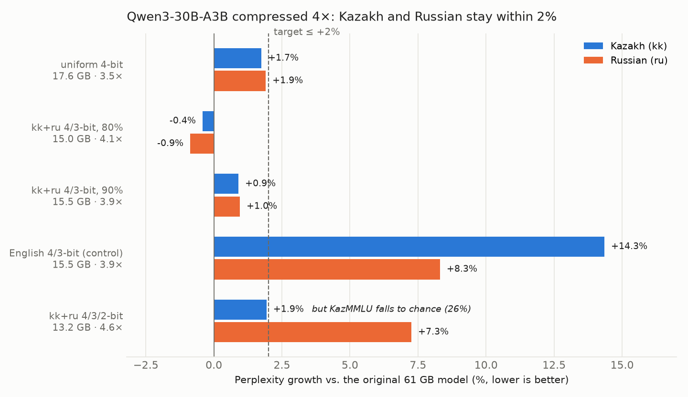
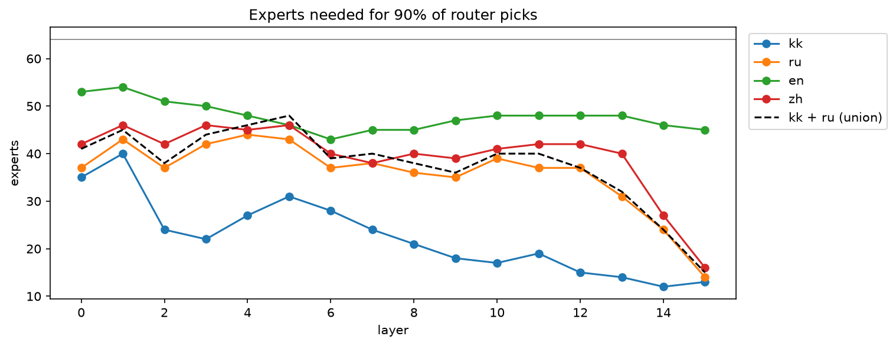
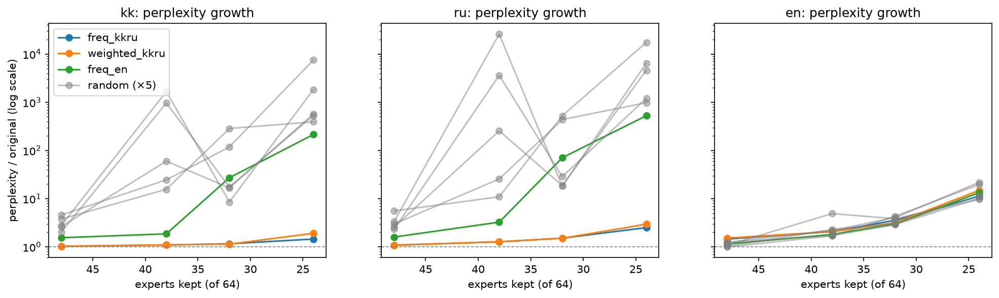

<div align="center">


**Language-aware compression for Mixture-of-Experts LLMs.**
Measure which experts your languages use, give them the bits, calibrate on your languages, and check that nothing broke.
First target: Kazakh 🇰🇿 + Russian.

<p>
<a href="LICENSE"></a>
<a href="https://github.com/s0nakh/linguaprune/actions/workflows/tests.yml"></a>
<a href="https://github.com/s0nakh/linguaprune/stargazers"></a>
<a href="https://github.com/s0nakh/linguaprune/commits/main"></a>
<a href="#roadmap"></a>
</p>
<p>
<a href="https://www.python.org/"></a>
<a href="https://pytorch.org/"></a>
<a href="https://github.com/huggingface/transformers"></a>
<a href="https://www.kaggle.com/"></a>
</p>
<p>
<a href="https://huggingface.co/Qwen/Qwen3-30B-A3B-Instruct-2507"></a>
<a href="#-evaluation"></a>
<a href="#"></a>
<a href="README.ru.md"></a>
</p>

[Русская версия](README.ru.md) · [Research log](docs/research-log.md) · [Related work](docs/prior-art.md)

</div>

---

## 🏆 Result

**Qwen3-30B-A3B goes from 61 GB to a real 15.24 GB file (4.0× smaller) while Kazakh perplexity grows by 1.3% and Russian by 0.4%.** Every number in this table is scored from the written file, not from a simulation.

| Qwen3-30B-A3B | On disk | kk perplexity | ru perplexity | KazMMLU kk | KazMMLU ru | Belebele kk / ru / en |
|---|---|---|---|---|---|---|
| Original (16-bit) | 61.1 GB | — | — | 66.8% | 71.4% | 77.3% / 92.7% / 92.7% |
| **kk+ru 4/3-bit** (90% of kk+ru traffic at 4 bits) | **15.24 GB · 4.0×** | **+1.3%** | **+0.4%** | **65.1%** | **70.9%** | **78.7% / 91.3% / 93.3%** |
| kk+ru 4-bit | 17.39 GB · 3.5× | +1.2% | +1.4% | 64.9% | 71.7% | 76.0% / 92.7% / 94.0% |

The file uses the standard GPTQ layout. Scoring it from disk gives exactly the same answers as the model in memory (largest difference 0.0). Data: [`experiments/07/full/`](experiments/07/full/).

**Why the language matters.** At equal memory, choosing bits and calibration by English text instead of Kazakh and Russian costs Kazakh 16× more (notebook 06, same pipeline, before the file format):

| Configuration (notebook 06) | Memory | kk perplexity | ru perplexity | KazMMLU kk | KazMMLU ru | Belebele kk / ru |
|---|---|---|---|---|---|---|
| Uniform 4-bit, kk+ru calibration | 17.6 GB · 3.5× | +1.7% | +1.9% | 65.1% | 70.9% | 77.3% / 93.3% |
| kk+ru 4/3-bit, 90% of traffic at 4 bits | 15.5 GB · 3.9× | +0.9% | +1.0% | 64.1% | 71.7% | 77.3% / 92.7% |
| kk+ru 4/3-bit, 80% of traffic at 4 bits | 15.0 GB · 4.1× | −0.4% | −0.9% | 64.9% | 69.4% | 77.3% / 89.3% |
| English 4/3-bit (control, same memory) | 15.5 GB · 3.9× | +14.3% | +8.3% | 67.0% | 72.2% | 74.7% / 91.3% |



> [!IMPORTANT]
> **The target was fixed before the run and is met:** at least 3.5× smaller than 16-bit, perplexity growth of at most 2% for both kk and ru, and no KazMMLU drop beyond noise.
> At the same memory, choosing bits and calibration by English text costs Kazakh **16× more** (+14.3% vs. +0.9%).

> [!WARNING]
> **What this result is not (yet):**
> - The file is tested only with this package's own loader. Loading in vLLM and other runtimes, and speed, are the [next step](#roadmap).
> - KazMMLU for Kazakh trends down: −1.6 points for the file, −2.7 in notebook 06 (paired 95% CI −5.4 to 0.0, McNemar p = 0.08). That is not significant on 370 questions, so the full KazMMLU run comes next.
> - One model, one seed, 762 KazMMLU questions and 150 Belebele passages per language.

All raw scores, per question: [`experiments/07/full/`](experiments/07/full/) and [`experiments/06/full/`](experiments/06/full/). The paired tests are in the [research log](docs/research-log.md#2026-11-12--06--qwen3-30b-a3b-compressed-4).

## 💡 Why

Sovereign and multilingual MoE models are huge, and Kazakh users rarely need what an English-centric compression keeps.
A 30B MoE in 16-bit needs 61 GB, which means a server GPU. At 15.24 GB the weights would fit a 24 GB consumer card, but common runtimes cannot yet run different bit widths for experts of the same layer; that is part of the next step.

The open question is *which* weights can lose precision without hurting a low-resource language.
Standard quantizers calibrate on English text. We show on Qwen3 that this choice alone costs Kazakh 16× more quality at the same memory.

> [!NOTE]
> This is an **empirical study and an open tool**, not a brand-new algorithm. GPTQ ([arXiv:2210.17323](https://arxiv.org/abs/2210.17323)), expert pruning (e.g. REAP) and language-specific pruning exist already; see [related work](docs/prior-art.md).
> Our contribution: Kazakh + Russian, measured against controls at equal memory, reproducible on free GPUs, and honest about losses.

## ⚙️ How it works

```
kk + ru text ──► router statistics ──► which experts carry kk/ru traffic, per layer
                                             │
                   experts covering 90% of the traffic ─► 4 bits, the rest ─► 3 bits
                                             │
              GPTQ per expert, calibrated only on the kk/ru tokens routed to it
                                             │
       exam: perplexity · KazMMLU · Belebele · factual probes, vs. English control
```

- **Streaming.** The 61 GB model never sits in memory. `linguaprune.streaming` loads one decoder layer at a time from the safetensors files, so the whole run (6 configurations) takes 2.5 hours on one free Kaggle T4.
- **Attention** stays at 8 bits and embeddings at 16 bits; experts hold almost all of the weights.
- **Calibration never sees the exam.** Calibration is Wikipedia; the exam is KazMMLU and Belebele. A test in CI checks the separation.

## 🧪 Evaluation

| Exam | What it measures | Size |
|---|---|---|
| Perplexity on [Belebele](https://huggingface.co/datasets/facebook/belebele) passages | Language modelling, same content in kk / ru / en | 150 passages per language |
| [KazMMLU](https://huggingface.co/datasets/MBZUAI/KazMMLU) | School and university knowledge in Kazakh and Russian | 370 kk + 392 ru questions, subject-balanced |
| Belebele multiple choice | Reading comprehension | 150 per language |
| Factual probes | e.g. "the capital of Kazakhstan is Astana", scored by likelihood | 3 per language |

Every compressed model is compared **per question** with the original (paired bootstrap and McNemar test), and against a control with the same memory.

## 📓 Notebooks

| # | Notebook | Question | Run your own copy |
|---|---|---|---|
| 01 | [`01_expert_profiling`](notebooks/01_expert_profiling.ipynb) | Which experts does each language use? | [](https://kaggle.com/kernels/welcome?src=https://github.com/s0nakh/linguaprune/blob/main/notebooks/01_expert_profiling.ipynb) |
| 02 | [`02_prune_and_measure`](notebooks/02_prune_and_measure.ipynb) | Does pruning by kk+ru routing keep quality? | [](https://kaggle.com/kernels/welcome?src=https://github.com/s0nakh/linguaprune/blob/main/notebooks/02_prune_and_measure.ipynb) |
| 03 | [`03_remove_and_save`](notebooks/03_remove_and_save.ipynb) | Does a physically smaller checkpoint match? | [](https://kaggle.com/kernels/welcome?src=https://github.com/s0nakh/linguaprune/blob/main/notebooks/03_remove_and_save.ipynb) |
| 04 | [`04_language_aware_quantization`](notebooks/04_language_aware_quantization.ipynb) | Mixed precision by kk+ru traffic (round-to-nearest) | [](https://kaggle.com/kernels/welcome?src=https://github.com/s0nakh/linguaprune/blob/main/notebooks/04_language_aware_quantization.ipynb) |
| 05 | [`05_gptq_streaming`](notebooks/05_gptq_streaming.ipynb) | GPTQ calibrated on kk+ru, layer by layer | [](https://kaggle.com/kernels/welcome?src=https://github.com/s0nakh/linguaprune/blob/main/notebooks/05_gptq_streaming.ipynb) |
| 06 | [`06_qwen3_language_aware_gptq`](notebooks/06_qwen3_language_aware_gptq.ipynb) | Qwen3-30B-A3B on a free T4: which bits, which calibration | [](https://kaggle.com/kernels/welcome?src=https://github.com/s0nakh/linguaprune/blob/main/notebooks/06_qwen3_language_aware_gptq.ipynb) |
| 07 | [`07_real_gptq_checkpoint`](notebooks/07_real_gptq_checkpoint.ipynb) | **The result above:** writes the real GPTQ files and re-scores them from disk | [](https://kaggle.com/kernels/welcome?src=https://github.com/s0nakh/linguaprune/blob/main/notebooks/07_real_gptq_checkpoint.ipynb) |

Notebooks are bilingual: English first, Russian below each text cell.
To run one: *Open in Kaggle* → **Accelerator: GPU T4** and **Internet: On** → **Save Version → Save & Run All**. Results land in `/kaggle/working/results`.

## 🧭 How we got here

Each step answered one question and changed the plan. Negative results stay in; the full story with dates is in the [research log](docs/research-log.md).

<details>
<summary><b>01 · Kazakh uses far fewer experts than English</b> (OLMoE-1B-7B)</summary>

<br>

Experts needed to cover 90% of router picks, of 64 per layer (100k Wikipedia tokens per language):

| Language | Experts |
|---|---|
| Kazakh (kk) | **22.5** |
| Russian (ru) | 35.9 |
| Chinese (zh) | 39.5 |
| English (en) | 47.8 |

- kk + ru together need ~37.7 (bootstrap 95% CI 37.3–38.4). On held-out articles the chosen experts still cover 96% (kk) and 91% (ru).
- Deep layers need far fewer experts: in layer 14, Kazakh needs 12 of 64.
- Two independent runs gave identical numbers.



Data: [`experiments/01/`](experiments/01/)
</details>

<details>
<summary><b>02 · Pruning by kk+ru routing beats random and English choice by far</b></summary>

<br>

Perplexity relative to the unpruned model on Belebele passages (1.00× = no loss):

| Experts kept (of 64) | kk · ours | kk · random (5 draws) | kk · English-chosen | ru · ours | ru · random | en · ours |
|---|---|---|---|---|---|---|
| 48 | **1.03×** | 2.0–4.6× | 1.55× | **1.09×** | 2.3–5.6× | 1.45× |
| 38 (−41%) | **1.10×** | 16–1668× | 1.86× | **1.27×** | 11–25983× | 2.08× |
| 32 | **1.16×** | 8.5–285× | 27× | **1.51×** | 18–523× | 3.56× |
| 24 | **1.45×** | 393–7544× | 214× | **2.51×** | 981–17520× | 11.2× |



- Language-aware choice works relative to controls, but Russian loses 27% at 38 experts.
- Router-weighted selection did not beat plain frequency.

Data: [`experiments/02/`](experiments/02/)
</details>

<details>
<summary><b>03 · Deleting experts saves memory but deletes knowledge</b></summary>

<br>

| | Original | Pruned (38/64 experts per layer) |
|---|---|---|
| Parameters | 6.92B | **4.30B (−38%)** |
| Size in fp16 | 13.8 GB | **8.6 GB** |
| Perplexity vs. original, kk / ru / en | 1.00× | 1.10× / 1.27× / 2.08× |

- The saved checkpoint matches the masked simulation (perplexity within 0.07%).
- But the pruned model answers "Almaty" instead of "Astana" in Russian. **Decision: keep every expert and compress instead.**

Data: [`experiments/03/`](experiments/03/)
</details>

<details>
<summary><b>04 · Bits by kk+ru traffic help, but round-to-nearest is too lossy</b></summary>

<br>

| Configuration (OLMoE) | kk | ru | Memory |
|---|---|---|---|
| uniform 4-bit | +6.4% | +4.5% | 4.38 GB (3.2×) |
| kk+ru 4/3-bit | +8.8% | +6.8% | 3.83 GB (3.6×) |
| English 4/3-bit (same memory) | +16.5% | +13.6% | 3.83 GB |
| kk+ru 4/3/2-bit | +13% | +17% | 3.30 GB (4.2×) |
| English 4/3/2-bit (same memory) | +217% | +289% | 3.30 GB |

Target not met. The allocation works; the quantizer is the bottleneck.

Data: [`experiments/04/`](experiments/04/)
</details>

<details>
<summary><b>05 · GPTQ with kk+ru calibration cuts the loss 3–4×</b></summary>

<br>

| Configuration (OLMoE) | kk | ru | en | Memory |
|---|---|---|---|---|
| RTN 4-bit | +6.6% | +4.5% | +15.2% | 4.12 GB (3.4×) |
| **GPTQ 4-bit, kk+ru calibration** | **+1.5%** | **+1.5%** | −1.1% | 4.12 GB (3.4×) |
| GPTQ kk+ru 4/3 | +2.2% | +4.4% | +18.7% | 3.57 GB (3.9×) |
| GPTQ English 4/3 (same memory) | +20.2% | +13.4% | −9.2% | 3.57 GB (3.9×) |
| GPTQ kk+ru 4/3/2 | +2.0% | +18.4% | +287% | 3.04 GB (4.6×) |

Russian was the weak spot, so step 06 added a variant that keeps 90% of kk+ru traffic at 4 bits.

Data: [`experiments/05/`](experiments/05/)
</details>

<details>
<summary><b>06 · Qwen3-30B-A3B: 2-bit experts break knowledge that perplexity hides</b></summary>

<br>

The 4/3/2-bit variant (13.2 GB, 4.6×) keeps Kazakh perplexity at +1.9%, yet KazMMLU falls to **26%** (chance level) and Belebele to 36%.
**Perplexity on one language alone is not a safe quality check**, which is why every result above is also scored on KazMMLU and Belebele.

Data: [`experiments/06/`](experiments/06/)
</details>

<a id="roadmap"></a>
## 🗺️ Roadmap

✅ done · 🔥 next · ⬜ planned

- ✅ 01–05 · Routing profile, pruning, physical removal, mixed precision, GPTQ on OLMoE
- ✅ 06 · Qwen3-30B-A3B: at equal memory, English calibration costs Kazakh 16× more than kk+ru
- ✅ 07 · **A real 15.24 GB file (4.0× smaller), kk/ru within 2%, scored from disk**
- 🔥 Run the file in vLLM and other runtimes; measure speed; compare with popular 4-bit versions
- ⬜ Full KazMMLU and MERA to settle the 2–3 point trend for Kazakh
- ⬜ `linguaprune` command line: profile → allocate → quantize → export, for any language pair
- ⬜ Second language pair and a second MoE family

## 📦 Python package

```bash
pip install "git+https://github.com/s0nakh/linguaprune@v0.4.0"
```

| Module | What it does |
|---|---|
| `linguaprune.pruning` | Router statistics, expert masks, physical expert removal |
| `linguaprune.quant` | Bit allocation by language traffic, round-to-nearest, memory accounting |
| `linguaprune.gptq` | Batched per-expert GPTQ with routed calibration tokens |
| `linguaprune.streaming` | Layer-by-layer evaluation of models larger than GPU memory |
| `linguaprune.belebele` | Belebele and multiple-choice scoring |

Tests compare every transformation with a reference implementation of the MoE classes from `transformers` 5.x: `pip install -e ".[test]" && pytest`.

## 🛠️ Development

Notebooks are edited as plain Python (`# %%` cells) and converted:

```bash
python3 scripts/py_to_ipynb.py notebooks/06_qwen3_language_aware_gptq.py
python3 scripts/plot_qwen3_result.py   # redraws the figure above from experiments/06/full
```

## 📚 Related work

Expert pruning (REAP), language-specific expert studies, and the closest work: English calibration erodes Lithuanian under expert pruning ([arXiv:2611.07654](https://arxiv.org/abs/2611.07654)). We see the same effect for Kazakh under quantization. The comparison with each is in [docs/prior-art.md](docs/prior-art.md).

## 📝 Citation

```bibtex
@software{linguaprune2026,
  title  = {LinguaPrune: Language-aware compression for Mixture-of-Experts LLMs},
  author = {Akhmetova, Sophia},
  year   = {2026},
  url    = {https://github.com/s0nakh/linguaprune}
}
```

## ⚖️ License

[Apache-2.0](LICENSE). Models and datasets keep their own licenses: Qwen3 is Apache-2.0, KazMMLU is CC-BY-NC-4.0 and Belebele is CC-BY-SA-4.0.
