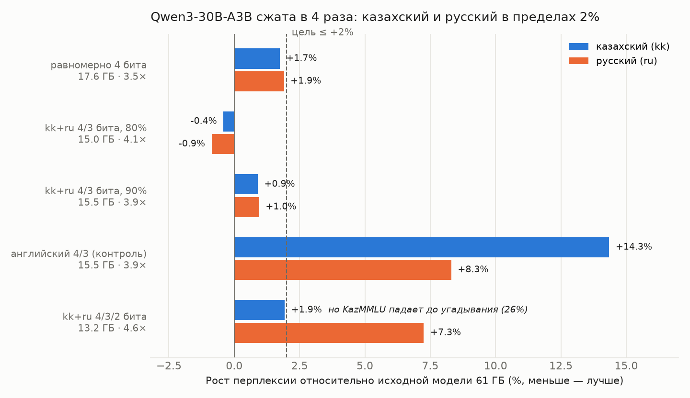
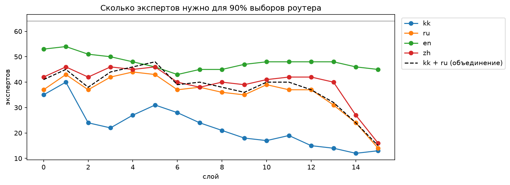
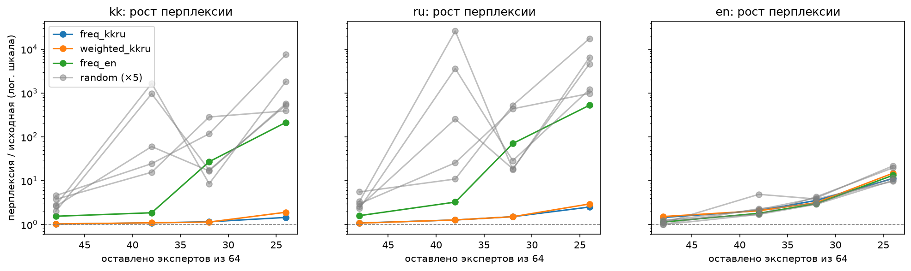

<div align="center">


**Языково-ориентированное сжатие MoE-моделей.**
Измеряем, каких экспертов используют ваши языки, отдаём им биты, калибруем на ваших языках и проверяем, что ничего не сломалось.
Первая цель — казахский 🇰🇿 + русский.

<p>
<a href="LICENSE"></a>
<a href="https://github.com/s0nakh/linguaprune/actions/workflows/tests.yml"></a>
<a href="https://github.com/s0nakh/linguaprune/stargazers"></a>
<a href="https://github.com/s0nakh/linguaprune/commits/main"></a>
<a href="#roadmap"></a>
</p>
<p>
<a href="https://www.python.org/"></a>
<a href="https://pytorch.org/"></a>
<a href="https://github.com/huggingface/transformers"></a>
<a href="https://www.kaggle.com/"></a>
</p>
<p>
<a href="https://huggingface.co/Qwen/Qwen3-30B-A3B-Instruct-2507"></a>
<a href="#-как-мы-проверяем"></a>
<a href="#"></a>
<a href="README.ru.md"></a>
</p>

[English](README.md) · [Исследовательский журнал](docs/research-log.ru.md) · [Связанные работы](docs/prior-art.ru.md)

</div>

---

## 🏆 Результат

**Qwen3-30B-A3B уменьшается с 61 ГБ до настоящего файла в 15,24 ГБ (в 4,0 раза), а перплексия казахского растёт на 1,3%, русского — на 0,4%.** Все цифры этой таблицы посчитаны с записанного файла, а не в имитации.

| Qwen3-30B-A3B | На диске | Перплексия kk | Перплексия ru | KazMMLU kk | KazMMLU ru | Belebele kk / ru / en |
|---|---|---|---|---|---|---|
| Исходная (16 бит) | 61,1 ГБ | — | — | 66,8% | 71,4% | 77,3% / 92,7% / 92,7% |
| **kk+ru 4/3 бита** (90% трафика kk+ru в 4 битах) | **15,24 ГБ · 4,0×** | **+1,3%** | **+0,4%** | **65,1%** | **70,9%** | **78,7% / 91,3% / 93,3%** |
| kk+ru 4 бита | 17,39 ГБ · 3,5× | +1,2% | +1,4% | 64,9% | 71,7% | 76,0% / 92,7% / 94,0% |

Файл в стандартном формате GPTQ. Оценка с диска даёт ровно те же ответы, что и модель в памяти (наибольшая разница 0,0). Данные: [`experiments/07/full/`](experiments/07/full/).

**Почему важен язык.** При той же памяти выбор битов и калибровка по английскому тексту вместо казахского и русского обходятся казахскому в 16 раз дороже (ноутбук 06, тот же конвейер, до перехода на формат файла):

| Вариант (ноутбук 06) | Память | Перплексия kk | Перплексия ru | KazMMLU kk | KazMMLU ru | Belebele kk / ru |
|---|---|---|---|---|---|---|
| Равномерно 4 бита, калибровка kk+ru | 17,6 ГБ · 3,5× | +1,7% | +1,9% | 65,1% | 70,9% | 77,3% / 93,3% |
| kk+ru 4/3 бита, 90% трафика в 4 битах | 15,5 ГБ · 3,9× | +0,9% | +1,0% | 64,1% | 71,7% | 77,3% / 92,7% |
| kk+ru 4/3 бита, 80% трафика в 4 битах | 15,0 ГБ · 4,1× | −0,4% | −0,9% | 64,9% | 69,4% | 77,3% / 89,3% |
| Английский 4/3 бита (контроль, та же память) | 15,5 ГБ · 3,9× | +14,3% | +8,3% | 67,0% | 72,2% | 74,7% / 91,3% |



> [!IMPORTANT]
> **Цель зафиксирована до прогона и достигнута:** сжатие не меньше 3,5× относительно 16 бит, рост перплексии kk и ru не больше 2%, KazMMLU не падает сверх шума.
> При той же памяти выбор битов и калибровка по английскому тексту обходятся казахскому **в 16 раз дороже** (+14,3% против +0,9%).

> [!WARNING]
> **Чем этот результат (пока) не является:**
> - Файл проверен только загрузчиком этого пакета. Запуск в vLLM и других программах и скорость — [следующий шаг](#roadmap).
> - KazMMLU по казахскому чуть ниже: −1,6 пункта у файла, −2,7 в ноутбуке 06 (парный 95% ДИ от −5,4 до 0,0, тест Макнемара p = 0,08). На 370 вопросах это незначимо, поэтому дальше — полный KazMMLU.
> - Одна модель, одно зерно, 762 вопроса KazMMLU и 150 отрывков Belebele на язык.

Все сырые оценки по каждому вопросу: [`experiments/07/full/`](experiments/07/full/) и [`experiments/06/full/`](experiments/06/full/). Парные тесты — в [исследовательском журнале](docs/research-log.ru.md).

## 💡 Зачем

Суверенные и многоязычные MoE-модели огромные, а казахским пользователям редко нужно то, что сохраняет сжатие, ориентированное на английский.
MoE на 30 млрд параметров в 16 битах весит 61 ГБ, то есть нужна серверная видеокарта. Веса в 15,24 ГБ поместились бы на потребительскую карту с 24 ГБ, но популярные программы пока не умеют запускать экспертов одного слоя с разным числом бит; это часть следующего шага.

Открытый вопрос — *какие* веса можно огрубить, не навредив малоресурсному языку.
Стандартные квантователи калибруются на английском тексте. На Qwen3 мы показываем, что один этот выбор при той же памяти стоит казахскому в 16 раз больше качества.

> [!NOTE]
> Это **эмпирическое исследование и открытый инструмент**, а не новый алгоритм. GPTQ ([arXiv:2210.17323](https://arxiv.org/abs/2210.17323)), прунинг экспертов (например, REAP) и языковой прунинг уже существуют, см. [связанные работы](docs/prior-art.ru.md).
> Наш вклад: казахский + русский, измерено против контролей при равной памяти, воспроизводимо на бесплатных GPU, честно о потерях.

## ⚙️ Как это работает

```
текст kk + ru ──► статистика роутера ──► какие эксперты несут трафик kk/ru в каждом слое
                                              │
               эксперты, покрывающие 90% трафика ─► 4 бита, остальные ─► 3 бита
                                              │
           GPTQ для каждого эксперта, калибровка только на его токенах kk/ru
                                              │
   экзамен: перплексия · KazMMLU · Belebele · фактические вопросы, против английского контроля
```

- **Потоковая обработка.** Модель на 61 ГБ никогда не лежит в памяти целиком. `linguaprune.streaming` читает из safetensors по одному слою, поэтому весь прогон (6 вариантов) занимает 2,5 часа на одной бесплатной T4 в Kaggle.
- **Attention** остаётся в 8 битах, эмбеддинги в 16 битах: почти все веса — в экспертах.
- **Калибровка никогда не видит экзамен.** Калибровка — Википедия, экзамен — KazMMLU и Belebele. Разделение проверяет тест в CI.

## 🧪 Как мы проверяем

| Экзамен | Что измеряет | Объём |
|---|---|---|
| Перплексия на отрывках [Belebele](https://huggingface.co/datasets/facebook/belebele) | Владение языком, один и тот же смысл на kk / ru / en | 150 отрывков на язык |
| [KazMMLU](https://huggingface.co/datasets/MBZUAI/KazMMLU) | Школьные и вузовские знания на казахском и русском | 370 kk + 392 ru вопроса, поровну по предметам |
| Belebele с выбором ответа | Понимание прочитанного | 150 на язык |
| Фактические вопросы | например, «столица Казахстана — Астана», по правдоподобию | 3 на язык |

Каждая сжатая модель сравнивается с исходной **по каждому вопросу** (парный бутстрэп и тест Макнемара) и с контролем той же памяти.

## 📓 Ноутбуки

| # | Ноутбук | Вопрос | Запустить свою копию |
|---|---|---|---|
| 01 | [`01_expert_profiling`](notebooks/01_expert_profiling.ipynb) | Каких экспертов использует каждый язык? | [](https://kaggle.com/kernels/welcome?src=https://github.com/s0nakh/linguaprune/blob/main/notebooks/01_expert_profiling.ipynb) |
| 02 | [`02_prune_and_measure`](notebooks/02_prune_and_measure.ipynb) | Сохраняет ли прунинг по kk+ru качество? | [](https://kaggle.com/kernels/welcome?src=https://github.com/s0nakh/linguaprune/blob/main/notebooks/02_prune_and_measure.ipynb) |
| 03 | [`03_remove_and_save`](notebooks/03_remove_and_save.ipynb) | Совпадает ли физически уменьшенная модель? | [](https://kaggle.com/kernels/welcome?src=https://github.com/s0nakh/linguaprune/blob/main/notebooks/03_remove_and_save.ipynb) |
| 04 | [`04_language_aware_quantization`](notebooks/04_language_aware_quantization.ipynb) | Смешанная точность по трафику kk+ru (округление) | [](https://kaggle.com/kernels/welcome?src=https://github.com/s0nakh/linguaprune/blob/main/notebooks/04_language_aware_quantization.ipynb) |
| 05 | [`05_gptq_streaming`](notebooks/05_gptq_streaming.ipynb) | GPTQ с калибровкой на kk+ru, по одному слою | [](https://kaggle.com/kernels/welcome?src=https://github.com/s0nakh/linguaprune/blob/main/notebooks/05_gptq_streaming.ipynb) |
| 06 | [`06_qwen3_language_aware_gptq`](notebooks/06_qwen3_language_aware_gptq.ipynb) | Qwen3-30B-A3B на бесплатной T4: какие биты, какая калибровка | [](https://kaggle.com/kernels/welcome?src=https://github.com/s0nakh/linguaprune/blob/main/notebooks/06_qwen3_language_aware_gptq.ipynb) |
| 07 | [`07_real_gptq_checkpoint`](notebooks/07_real_gptq_checkpoint.ipynb) | **Результат выше:** пишет настоящие файлы GPTQ и заново оценивает их с диска | [](https://kaggle.com/kernels/welcome?src=https://github.com/s0nakh/linguaprune/blob/main/notebooks/07_real_gptq_checkpoint.ipynb) |

Ноутбуки двуязычные: сначала английский, под каждой текстовой ячейкой — русский.
Как запустить: *Open in Kaggle* → **Accelerator: GPU T4** и **Internet: On** → **Save Version → Save & Run All**. Результаты появятся в `/kaggle/working/results`.

## 🧭 Как мы к этому пришли

Каждый шаг отвечал на один вопрос и менял план. Отрицательные результаты не скрываем; полная история с датами — в [исследовательском журнале](docs/research-log.ru.md).

<details>
<summary><b>01 · Казахскому нужно намного меньше экспертов, чем английскому</b> (OLMoE-1B-7B)</summary>

<br>

Сколько экспертов из 64 в слое покрывают 90% выборов роутера (100 тыс. токенов Википедии на язык):

| Язык | Экспертов |
|---|---|
| Казахский (kk) | **22,5** |
| Русский (ru) | 35,9 |
| Китайский (zh) | 39,5 |
| Английский (en) | 47,8 |

- kk + ru вместе нужно ~37,7 (бутстрэп 95% ДИ 37,3–38,4). На отложенных статьях выбранные эксперты покрывают 96% (kk) и 91% (ru).
- Глубоким слоям нужно намного меньше: в слое 14 казахскому хватает 12 из 64.
- Два независимых прогона дали одинаковые цифры.



Данные: [`experiments/01/`](experiments/01/)
</details>

<details>
<summary><b>02 · Прунинг по маршрутизации kk+ru намного лучше случайного и английского выбора</b></summary>

<br>

Перплексия относительно исходной модели на отрывках Belebele (1,00× = без потерь):

| Оставлено экспертов (из 64) | kk · наш | kk · случайные (5 раз) | kk · по английскому | ru · наш | ru · случайные | en · наш |
|---|---|---|---|---|---|---|
| 48 | **1,03×** | 2,0–4,6× | 1,55× | **1,09×** | 2,3–5,6× | 1,45× |
| 38 (−41%) | **1,10×** | 16–1668× | 1,86× | **1,27×** | 11–25983× | 2,08× |
| 32 | **1,16×** | 8,5–285× | 27× | **1,51×** | 18–523× | 3,56× |
| 24 | **1,45×** | 393–7544× | 214× | **2,51×** | 981–17520× | 11,2× |



- Языковой выбор работает относительно контролей, но русский при 38 экспертах теряет 27%.
- Взвешивание по оценке роутера не лучше простой частоты.

Данные: [`experiments/02/`](experiments/02/)
</details>

<details>
<summary><b>03 · Удаление экспертов экономит память, но стирает знания</b></summary>

<br>

| | Исходная | После прунинга (38/64 эксперта в слое) |
|---|---|---|
| Параметры | 6,92 млрд | **4,30 млрд (−38%)** |
| Размер в fp16 | 13,8 ГБ | **8,6 ГБ** |
| Перплексия относительно исходной, kk / ru / en | 1,00× | 1,10× / 1,27× / 2,08× |

- Сохранённая модель совпадает с имитацией маской (перплексия в пределах 0,07%).
- Но по-русски уменьшенная модель отвечает «Алматы» вместо «Астана». **Решение: не удалять экспертов, а сжимать.**

Данные: [`experiments/03/`](experiments/03/)
</details>

<details>
<summary><b>04 · Биты по трафику kk+ru помогают, но простое округление слишком грубое</b></summary>

<br>

| Вариант (OLMoE) | kk | ru | Память |
|---|---|---|---|
| равномерно 4 бита | +6,4% | +4,5% | 4,38 ГБ (3,2×) |
| kk+ru 4/3 бита | +8,8% | +6,8% | 3,83 ГБ (3,6×) |
| английский 4/3 бита (та же память) | +16,5% | +13,6% | 3,83 ГБ |
| kk+ru 4/3/2 бита | +13% | +17% | 3,30 ГБ (4,2×) |
| английский 4/3/2 бита (та же память) | +217% | +289% | 3,30 ГБ |

Цель не достигнута. Распределение битов работает, узкое место — квантователь.

Данные: [`experiments/04/`](experiments/04/)
</details>

<details>
<summary><b>05 · GPTQ с калибровкой на kk+ru снижает потери в 3–4 раза</b></summary>

<br>

| Вариант (OLMoE) | kk | ru | en | Память |
|---|---|---|---|---|
| RTN 4 бита | +6,6% | +4,5% | +15,2% | 4,12 ГБ (3,4×) |
| **GPTQ 4 бита, калибровка kk+ru** | **+1,5%** | **+1,5%** | −1,1% | 4,12 ГБ (3,4×) |
| GPTQ kk+ru 4/3 | +2,2% | +4,4% | +18,7% | 3,57 ГБ (3,9×) |
| GPTQ английский 4/3 (та же память) | +20,2% | +13,4% | −9,2% | 3,57 ГБ (3,9×) |
| GPTQ kk+ru 4/3/2 | +2,0% | +18,4% | +287% | 3,04 ГБ (4,6×) |

Слабым местом был русский, поэтому в шаг 06 добавлен вариант, где 90% трафика kk+ru остаётся в 4 битах.

Данные: [`experiments/05/`](experiments/05/)
</details>

<details>
<summary><b>06 · Qwen3-30B-A3B: эксперты в 2 битах ломают знания, а перплексия этого не видит</b></summary>

<br>

Вариант 4/3/2 бита (13,2 ГБ, 4,6×) держит перплексию казахского на +1,9%, но KazMMLU падает до **26%** (уровень угадывания), а Belebele до 36%.
**Перплексия одного языка — ненадёжная проверка качества.** Поэтому каждый результат выше оценён ещё и на KazMMLU и Belebele.

Данные: [`experiments/06/`](experiments/06/)
</details>

<a id="roadmap"></a>
## 🗺️ Дорожная карта

✅ сделано · 🔥 следующее · ⬜ в планах

- ✅ 01–05 · Профиль маршрутизации, прунинг, физическое удаление, смешанная точность, GPTQ на OLMoE
- ✅ 06 · Qwen3-30B-A3B: при той же памяти английская калибровка обходится казахскому в 16 раз дороже, чем kk+ru
- ✅ 07 · **Настоящий файл 15,24 ГБ (в 4,0 раза меньше), kk/ru в пределах 2%, оценка с диска**
- 🔥 Запуск файла в vLLM и других программах; скорость; сравнение с популярными 4-битными версиями
- ⬜ Полный KazMMLU и MERA, чтобы разрешить тренд в 2–3 пункта для казахского
- ⬜ Командная строка `linguaprune`: профиль → биты → квантование → экспорт, для любой пары языков
- ⬜ Вторая пара языков и второе семейство MoE

## 📦 Python-пакет

```bash
pip install "git+https://github.com/s0nakh/linguaprune@v0.4.0"
```

| Модуль | Что делает |
|---|---|
| `linguaprune.pruning` | Статистика роутера, маски экспертов, физическое удаление |
| `linguaprune.quant` | Биты по языковому трафику, округление, подсчёт памяти |
| `linguaprune.gptq` | Пакетный GPTQ для каждого эксперта на его калибровочных токенах |
| `linguaprune.streaming` | Оценка моделей больше памяти GPU, по одному слою |
| `linguaprune.belebele` | Belebele и оценка ответов с выбором |

Тесты сравнивают каждое преобразование с эталонной реализацией MoE-классов из `transformers` 5.x: `pip install -e ".[test]" && pytest`.

## 🛠️ Разработка

Ноутбуки редактируются как обычный Python (ячейки `# %%`) и конвертируются:

```bash
python3 scripts/py_to_ipynb.py notebooks/06_qwen3_language_aware_gptq.py
python3 scripts/plot_qwen3_result.py   # перерисовывает график выше из experiments/06/full
```

## 📚 Связанные работы

Прунинг экспертов (REAP), исследования языковой специализации экспертов и ближайшая работа: английская калибровка разрушает литовский при прунинге экспертов ([arXiv:2611.07654](https://arxiv.org/abs/2611.07654)). Мы видим тот же эффект для казахского при квантовании. Сравнение с каждой работой — в [docs/prior-art.ru.md](docs/prior-art.ru.md).

## 📝 Цитирование

```bibtex
@software{linguaprune2026,
  title  = {LinguaPrune: Language-aware compression for Mixture-of-Experts LLMs},
  author = {Akhmetova, Sophia},
  year   = {2026},
  url    = {https://github.com/s0nakh/linguaprune}
}
```

## ⚖️ Лицензия

[Apache-2.0](LICENSE). У моделей и датасетов свои лицензии: Qwen3 — Apache-2.0, KazMMLU — CC-BY-NC-4.0, Belebele — CC-BY-SA-4.0.
