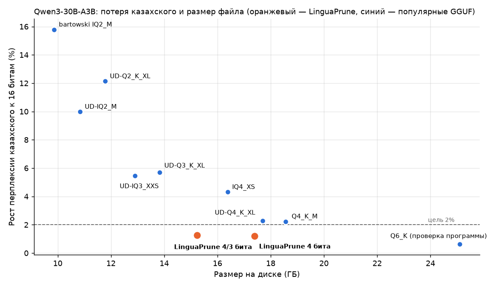

# Исследовательский журнал

*[English](research-log.md) · [К README](../README.ru.md)*

Датированная запись каждого эксперимента: вопрос, постановка, результат и решение, к которому он привёл. Отрицательные результаты остаются в журнале. Сырые данные лежат в [`experiments/`](../experiments/).

**Постоянные правила:**
- Экзамен — Belebele: одни и те же 150 отрывков на kk / ru / en. Для калибровки он никогда не используется.
- Калибровка — Википедия.
- Главная метрика — перплексия относительно исходной модели.
- Каждый результат сравнивается с **контролем при одинаковой памяти**: случайными экспертами и экспертами, выбранными по английскому.
- Память для квантования **посчитана**, а не измерена: квантование имитируется, если не сказано иное.

---

## 2026-11-10 · 01 · Каких экспертов использует каждый язык?

- **Постановка.** OLMoE-1B-7B, по 100 тыс. токенов Википедии на kk, ru, en, zh. Считаем, какой минимальный набор экспертов покрывает 90% выборов роутера.
- **Результат.**
  - Нужно экспертов: kk **22,5** из 64, ru 35,9, zh 39,5, en 47,8; kk ∪ ru — 37,7 (95% ДИ 37,3–38,4).
  - Глубокие слои концентрированнее: в слое 14 казахскому хватает 12 экспертов.
  - Повторный прогон совпал полностью.
- **Решение.** Маршрутизация достаточно языковая, чтобы пробовать прунинг. Дальше меряем качество.

## 2026-11-11 · 02 · Сохраняет ли прунинг по kk+ru качество?

- **Результат** при 38 из 64 экспертов:

  | Язык | Наш выбор | Случайный выбор | Выбор по английскому |
  |---|---|---|---|
  | kk | ×1,10 | ×16–1668 | ×1,86 |
  | ru | ×1,27 | — | ×3,26 |

- **Решение.** Языковой выбор работает относительно контролей, но русский теряет много. Следующий шаг — физическое удаление экспертов.

## 2026-11-11 · 03 · Физическое удаление

- **Результат.**
  - 6,92 → 4,30 млрд параметров (13,8 → 8,6 ГБ), совпадение с маской 0,07%.
  - Но по-русски модель отвечает «Алматы» вместо «Астана».
- **Решение.** Удаление стирает знания. Дальше не удаляем, а сжимаем редких экспертов сильнее.

## 2026-11-11 · 04 · Языковая смешанная точность (RTN)

- **Результат.**
  - Цель (≥ 3,5× при ≤ +2%) **не достигнута**.
  - При одинаковой памяти наш вариант лучше английского: kk +8,8% против +16,5% при 4/3 битах.
  - Но даже равномерные 4 бита RTN теряют +6,4%.
- **Решение.** Узкое место — квантователь. Переходим на GPTQ.

## 2026-11-12 · Инженерия: обработка по одному слою

- **Что сделано.** Qwen3-30B (61 ГБ) проходит через бесплатную T4 по одному слою.
- **Проверка.** Совпадение с обычным запуском модели проверено тестами на настоящих OLMoE и Qwen3-MoE.
- **Инцидент.** Пакетное `cholesky_inverse` (MAGMA) падало на T4. Теперь обращение матриц считается по одной, через треугольные решатели. Ошибку поймал пробный прогон на 2 слоях.

## 2026-11-12 · 05 · GPTQ с калибровкой на kk+ru

| Вариант | kk | ru | Сжатие |
|---|---|---|---|
| RTN 4 бита | +6,6% | +4,5% | 3,4× |
| **GPTQ 4 бита, kk+ru** | **+1,5%** | **+1,5%** | 3,4× |
| GPTQ kk+ru 4/3 | +2,2% | +4,4% | 3,9× |
| GPTQ английский 4/3 | +20,2% | +13,4% | 3,9× |
| GPTQ kk+ru 4/3/2 | +2,0% | +18,4% | 4,6× |

- **Решение.**
  - GPTQ снижает потери в 3–4 раза, и язык калибровки решает.
  - Слабое место — русский. В следующем прогоне 4 бита получат эксперты, на которых приходится 90% трафика kk+ru.

## 2026-11-12 · 06 · Знает ли Qwen3-30B казахский?

- **Результат.**
  - Вся модель обработана за **15 минут** на одной T4.
  - KazMMLU **66,8%** kk / **71,4%** ru, Belebele 77,3% kk и 92,7% ru и en, факты 3/3. *(Исправлено 12.11.2026: раньше здесь было 92,7% для kk.)*
- **Решение.** Знает, поэтому запускаем прогон со сжатием.

## 2026-11-12 · 06 · Qwen3-30B-A3B сжата в 4 раза

- **Цель**, зафиксированная до прогона: сжатие ≥ 3,5×, рост перплексии kk и ru ≤ 2%, KazMMLU не ниже сверх шума.
- **Постановка.**
  - Qwen3-30B-A3B, потоково по одному слою на одной T4 (145 минут на 6 вариантов).
  - GPTQ для экспертов, калибровка на 64 статьях kk + 64 ru (английский — для контроля).
  - 4 бита получают эксперты, покрывающие 80% или 90% трафика kk+ru, остальные — 3 бита.
  - Экзамен: перплексия и точность Belebele, KazMMLU (370 kk + 392 ru), фактические вопросы; парное сравнение с исходной моделью по каждому вопросу.
- **Результат.**

  | Вариант | Память | ppl kk | ppl ru | KazMMLU kk | KazMMLU ru | Belebele kk / ru |
  |---|---|---|---|---|---|---|
  | исходная | 61,1 ГБ | — | — | 66,8% | 71,4% | 77,3 / 92,7% |
  | GPTQ 4 бита | 17,6 ГБ (3,5×) | +1,7% | +1,9% | −1,6 п. | −0,5 п. | 0,0 / +0,7 п. |
  | **kk+ru 4/3 @90%** | **15,5 ГБ (3,9×)** | **+0,9%** | **+1,0%** | −2,7 п. | +0,3 п. | 0,0 / 0,0 п. |
  | **kk+ru 4/3 @80%** | **15,0 ГБ (4,1×)** | **−0,4%** | **−0,9%** | −1,9 п. | −2,0 п. | 0,0 / −3,3 п. |
  | английский 4/3 @90% (контроль) | 15,5 ГБ (3,9×) | +14,3% | +8,3% | +0,3 п. | +0,8 п. | −2,7 / −1,3 п. |
  | kk+ru 4/3/2 | 13,2 ГБ (4,6×) | +1,9% | +7,3% | −40,8 п. | −47,7 п. | −41,3 / −54,0 п. |

  - Парные тесты: для двух целевых вариантов ни одно отличие не значимо на уровне 0,05. Ближе всего — KazMMLU kk у варианта 90%: −2,7 п. [−5,4; 0,0], p = 0,08. Все отличия варианта 4/3/2 значимы (p < 0,001).
  - Фактические вопросы — 3/3 на всех языках во всех вариантах.
  - **Цель достигнута** вариантами kk+ru 4/3 при 80% и 90%.
- **Наблюдения.**
  - При равной памяти английская калибровка стоит перплексии казахского в 16 раз дороже (+14,3% против +0,9%).
  - Но KazMMLU эти варианты не различает: английский контроль держит KazMMLU, а все варианты kk+ru показывают по kk тренд −2–3 пункта. На 370 вопросах нельзя сказать, шум ли это.
  - Эксперты в 2 битах ломают модель, хотя перплексия казахского +1,9%. Перплексия одного языка сама по себе — ненадёжная проверка.
  - Отрицательный рост перплексии при 80% скорее всего связан с калибровкой на похожих текстах (Википедия) и не означает, что сжатая модель лучше.
- **Решение.**
  - Рекомендуемый вариант — kk+ru 4/3 при 90% (Belebele без изменений на всех языках).
  - Дальше: настоящий файл с низкой разрядностью (измеренный размер и скорость), затем полный KazMMLU, чтобы разрешить тренд по kk.
- [Ноутбук](../notebooks/06_qwen3_language_aware_gptq.ipynb) · [данные](../experiments/06/full/)

## 2026-11-12 · 07 · Настоящий сжатый файл

- **Вопрос.** Сохраняются ли результаты 06, если записать модель настоящими файлами с низкой разрядностью и прочитать её обратно с диска?
- **Постановка.**
  - Та же модель, калибровка и экзамен, что в 06; GPTQ заново с linguaprune 0.5.0, где сетка квантования хранит масштабы в fp16 и целые нулевые точки ровно так же, как файл.
  - Формат — стандартный GPTQ v1: эксперты 4 или 3 бита (группа 128), внимание 8 бит, эмбеддинги и нормы 16 бит. Разрядность по модулям указана в поле `dynamic` в `quantization_config`.
  - Каждая сжатая строка таблицы посчитана **с записанного файла**, а не с модели в памяти. Одна Kaggle T4, 116 мин вместе с загрузкой.
- **Результат.**

  | Конфигурация | На диске | ppl kk | ppl ru | KazMMLU kk | KazMMLU ru | Belebele kk / ru / en |
  |---|---|---|---|---|---|---|
  | исходная | 61,1 ГБ | — | — | 66,8% | 71,4% | 77,3 / 92,7 / 92,7% |
  | **kk+ru 4/3 @90%** | **15,24 ГБ (4,0×)** | **+1,3%** | **+0,4%** | 65,1% | 70,9% | 78,7 / 91,3 / 93,3% |
  | kk+ru 4 бита | 17,39 ГБ (3,5×) | +1,2% | +1,4% | 64,9% | 71,7% | 76,0 / 92,7 / 94,0% |

  - Наибольшая разница оценок между моделью в памяти и файлом: **0,0** для обеих конфигураций.
  - Фактические вопросы: 3/3 на всех языках.
  - **Цель достигнута на настоящем файле**: в 4,0 раза меньше, перплексия kk и ru в пределах 2%.
- **Наблюдения.**
  - Цифры немного сдвинулись относительно 06 (kk +0,9% → +1,3%, ru +1,0% → +0,4%), потому что сетка квантования изменилась под формат файла; это разброс GPTQ между прогонами, а не потери при записи.
  - Разрыв KazMMLU kk здесь −1,6 п. против −2,7 п. в 06; закрыть вопрос должен полный KazMMLU.
  - Ещё не проверено: загрузка в vLLM и других программах, скорость.
- **Решение.** Опубликовать обе модели на Hugging Face; дальше — совместимость с программами и сравнение с популярными 4-битными версиями на том же экзамене.
- [Ноутбук](../notebooks/07_real_gptq_checkpoint.ipynb) · [данные](../experiments/07/full/)

## 2026-11-12 · 08 · Сжатая модель в обычной программе

- **Вопрос.** Прочитает ли файлы правильно программа, которую мы не контролируем, и будет ли модель отвечать на вопросы?
- **Постановка.**
  - [GPTQModel](https://github.com/ModelCloud/GPTQModel) 7.6.0 на transformers 5.20, ядро torch, две Kaggle T4.
  - GPTQModel не принимает несимметричные файлы в классическом формате GPTQ от других программ, поэтому каждая скачанная модель сначала переводится в её вариант `gptq_v2` (нулевые точки без сдвига на −1; больше ничего не меняется). Перевод добавлен в LinguaPrune 0.5.1.
  - Маленькая проверка: случайная двухслойная Qwen3-MoE со смесью модулей 3/4/8 бит, записанная LinguaPrune и загруженная GPTQModel.
  - Настоящие модели: 40 казахских и 40 русских отрывков Belebele, сравнение с ноутбуком 07 на тех же отрывках; пять вопросов на kk, ru и en, жадная генерация.
- **Результат.**
  - Маленькая проверка: разница 0,00003 ната на токен между LinguaPrune и GPTQModel.

  | Модель | Память GPU | ppl kk к ноутбуку 07 | ppl ru к ноутбуку 07 | Скорость |
  |---|---|---|---|---|
  | kk+ru 4 бита | 17,4 ГБ | +0,01% | −0,08% | 1,6 токена/с |
  | kk+ru 4/3 бита | 15,3 ГБ | −0,04% | +0,01% | 1,6 токена/с |

  - Обе модели отвечают правильно и связно на казахском, русском и английском (столица, перевод, фотосинтез, реки, Абай). Ответы — в [`experiments/08/`](../experiments/08/).
  - Одна фактическая ошибка: модель 4/3 бита называет годом смерти Абая 1908 (верно 1904; 4-битная отвечает правильно).
- **Наблюдения.**
  - Файл со смесью 4/3 бит работает в обычной программе: GPTQModel читает каждый модуль с объявленной разрядностью.
  - Скорость низкая, потому что переносимое ядро torch распаковывает каждого эксперта при каждом вызове; быстрые ядра и vLLM ещё не проверены.
- **Решение.** Перезалить обе модели в формате `gptq_v2` с инструкцией запуска, затем попробовать vLLM и сборку GGUF для Ollama / LM Studio.
- [Ноутбук](../notebooks/08_run_with_gptqmodel.ipynb) · [данные](../experiments/08/)

## 2026-11-13 · 09 · Против популярных сжатых версий

- **Вопрос.** Популярные файлы GGUF той же модели настроены по английскому тексту. Сколько казахского и русского они теряют при каждом размере по сравнению с LinguaPrune?
- **Постановка.**
  - Девять файлов Qwen3-30B-A3B-Instruct-2507 от двух самых скачиваемых издателей GGUF (unsloth, bartowski), от Q6_K (25,1 ГБ) до IQ2_M (9,9 ГБ).
  - llama.cpp (llama-cpp-python 0.3.36, собран под T4) на двух Kaggle T4, контекст 4096 токенов.
  - Ровно экзамен ноутбука 07: те же 1239 заданий (перплексия и ответы Belebele kk/ru/en, KazMMLU kk/ru, проверка фактов), сверены поштучно с 16-битными оценками ноутбука 07.
  - Q6_K — проверка программы: при 6 битах потеря должна быть почти нулевой.
- **Результат.** Рост перплексии к 16 битам (меньше — лучше), точность в %.

  | Модель | На диске | kk | ru | en | KazMMLU kk / ru | Belebele kk |
  |---|---|---|---|---|---|---|
  | Q6_K (проверка программы) | 25,09 ГБ · 2,4× | +0,6% | +0,7% | +0,8% | 66,2 / 72,4 | 76,7 |
  | Q4_K_M | 18,56 ГБ · 3,3× | +2,2% | +2,2% | +2,1% | 64,3 / 71,4 | 78,7 |
  | UD-Q4_K_XL | 17,69 ГБ · 3,5× | +2,3% | +2,3% | +1,9% | 64,9 / 71,2 | 78,0 |
  | **LinguaPrune kk+ru 4 бита** | **17,39 ГБ · 3,5×** | **+1,2%** | **+1,4%** | +2,3% | 64,9 / 71,7 | 76,0 |
  | IQ4_XS | 16,38 ГБ · 3,7× | +4,3% | +3,6% | +6,5% | 64,9 / 72,2 | 75,3 |
  | **LinguaPrune kk+ru 4/3 бита** | **15,24 ГБ · 4,0×** | **+1,3%** | **+0,4%** | +3,2% | 65,1 / 70,9 | 78,7 |
  | UD-Q3_K_XL | 13,83 ГБ · 4,4× | +5,7% | +3,0% | +5,7% | 66,2 / 72,4 | 74,0 |
  | UD-IQ3_XXS | 12,91 ГБ · 4,7× | +5,4% | +3,6% | +3,2% | 65,1 / 70,4 | 75,3 |
  | UD-Q2_K_XL | 11,79 ГБ · 5,2× | +12,1% | +7,2% | +10,0% | 64,3 / 69,1 | 74,7 |
  | UD-IQ2_M | 10,85 ГБ · 5,6× | +10,0% | +5,3% | +6,7% | 65,4 / 70,4 | 72,0 |
  | bartowski IQ2_M | 9,87 ГБ · 6,2× | +15,8% | +5,7% | +11,5% | 61,4 / 68,9 | 75,3 |

  

- **Наблюдения.**
  - От 15 до 19 ГБ только файлы LinguaPrune укладываются в 2% и для казахского, и для русского. Файл 4/3 бита на 1,1 ГБ меньше IQ4_XS и теряет в 3,4 раза меньше казахского и в 9 раз меньше русского.
  - Проверка программы стоит 0,6–0,8% даже при 6 битах, значит часть каждой цифры GGUF — это сама программа, а не сжатие. Если её вычесть, Q4_K_M всё равно теряет больше казахского (+1,6%), чем любой файл LinguaPrune, а они того же размера (4 бита) или на 3,3 ГБ меньше (4/3 бита).
  - Мы платим английским: +3,2% у файла 4/3 бита против +2,1% у Q4_K_M. Это выбранный нами обмен.
  - Ниже 14 ГБ популярные файлы быстрее всего теряют казахский. При 2 битах казахский теряет в 1,5–2,8 раза больше русского, а KazMMLU kk падает на 5,4 пункта у IQ2_M на 9,9 ГБ.
  - Разница в KazMMLU и Belebele выше 12 ГБ — в пределах шума на 370 и 150 вопросах. Преимущество — в перплексии (сохранение текста), а не в знаниях: UD-Q3_K_XL на 13,8 ГБ набирает 66,2% на KazMMLU kk против 65,1% у нашего файла на 15,24 ГБ.
  - Не сравнивали: скорость. GGUF быстро работает в llama.cpp; наши файлы пока работают только в медленном ядре GPTQModel.
- **Решение.** Свободная ниша — 10–12 ГБ, где популярные файлы теряют 10–16% казахского. Дальше: файл ~2,5 бита с учётом языка под этот размер, kk и ru в пределах 2%, и сборка GGUF с нашим распределением битов, чтобы работать на скорости llama.cpp.
- [Ноутбук](../notebooks/09_popular_quants_on_kazakh.ipynb) · [данные](../experiments/09/)
